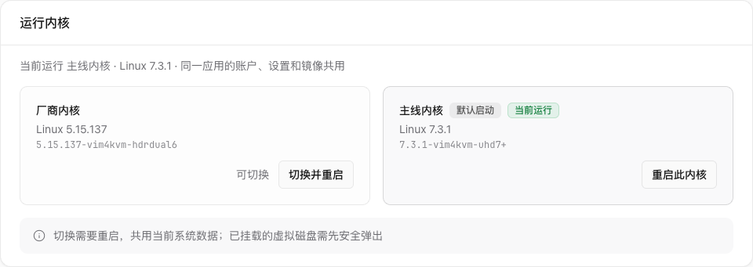

# 2026-11-03：内核命名统一、旧产物清理与管理面板

Mainline/Vendor 已在板上生效，默认 Mainline，运行内核仍为 `7.3.1-vim4kvm-uhd7+`。
本轮清理与管理面板冒烟通过；不重编内核，不重复宣称九类全量回归。
原内核来源与九类验收见[7.3.1整包部署](2026-11-03-kernel-731-deploy.md)。

## 输入与范围

- 主仓离线命名提交 `1f14d31`；退役 release 分支删除提交 `b685f25`。
- 内核源码 `25110086de2ef6aa9564a31a7c694eca893fd423`，build ID
  `58d9b0f4148da5c2275fac40f4e177a0d0cb301b`，完整 2341 模块，Image/DT/模块未重装。
- 管理器 main `910806eeb046616188722518061823e13b049bc5`，干净源码构建，
  安装包版本 `2.5.1+vim4.20261029.102.dev.7.g910806e`；构建与隔离 verify 均通过。
- 两张板票 `b15bd51e2cb54f7b918008a8b7487d66`、`d54f58c61de34ecbad734f87434f074b`，
  实际持有合计 485.36 秒（8.09 分钟）。构建期间释放板锁，没有采样与编译重叠。

## 删除与改名

删除前核对运行 release、全部 extlinux LABEL、kernels.json、uEnv.txt、顶层启动链接及
systemd 引用。保留 Vendor/hdrdual6 的启动文件/模块和 Mainline/7.3.1 的独立目录/模块。
旧三个实验 unit 的 rc7 版本条件已去掉；它们仍受显式实验启动参数约束，并被 Mainline 屏蔽。
删除清单逐目录记录分配空间；旧启动文件的 SHA256 在删除前写入日志，没有制作备份。

- `/boot/edge`：58,040,320 字节；删除 HdmirxTest、OneKvmTest 两个独占引用它的启动项。
- `/lib/modules`：删除 25 个目录，分别为 `5.15.137`、`5.15.137-vim4kvm-hdrdual5`、
  `5.15.137-vim4kvm-vapb1`；以及统一前缀 `7.3.0-vim4kvm-` 下的
  `npu1+`–`npu4+`、`uhd1+`、`uhd2+`、`uhd2-nodebug+`、`uhd3+`、`uhd3-gpu1+`、
  `uhd3-hdr2a1+`–`uhd3-hdr2a5+`、`uhd4+`、`uhd4r1+`–`uhd4r3+`、`uhd6+`、`uhd7+`、`vdec3+`、`vdec4+`。
- `/lib/firmware/updates`：删除 `7.3.0-vim4kvm-uhd6+`、`7.3.0-vim4kvm-uhd7+`，各 884,736 字节。
- 删除路径分配空间合计 690,769,920 字节，包含原本只有目录本身的旧候选模块目录。

extlinux 原子更新后只剩 `Vendor` 和 `Mainline`，default 为 Mainline；
FullKvm→Mainline、Default→Vendor，LINUX/FDT/厂商 INITRD 与 APPEND 语义不变。
按当前 register-runtime.py 重新登记完整模块，kernels.json 名称为「厂商内核」「主线内核」。
部署当前 vim4boot、平台/HDMI/USB 入口，应用启动器只删除旧 release 分派，保留已验 r14e/USB 程序路径。
runtime-build.json 的当前内核、默认项、管理器版本、入口哈希与加载身份同步更新。

`df -B1`（最终值在重启和接收完成后采集）：

| 分区 | 清理前 Used / Available | 完成后 Used / Available | Available 增量 |
|---|---:|---:|---:|
| /boot | 162,578,432 / 46,366,720 | 104,538,112 / 104,407,040 | 58,040,320 |
| / | 15,416,295,424 / 14,308,646,912 | 14,784,937,984 / 14,940,004,352 | 631,357,440 |

根分区净变化包含管理器升级、日志与正常运行写入，不等同于目录删除量。

## 重启和实际验收

串口当前是 `/dev/cu.usbserial-1100`；用 uart-log 确认登录提示、登录后用 uart-run 执行 uname。
PID1 在重启前后均持有 `/dev/watchdog0`，RuntimeWatchdogUSec=30s；
重启全程开启串口日志，只执行一次正常 systemctl reboot。

| 项目 | 实际结果 |
|---|---|
| boot ID | `1959c0c4-4ac5-4505-a7cf-ec192209c4ab` → `c59b6b0d-152d-4afe-a3aa-b48317839835` |
| uname | `7.3.1-vim4kvm-uhd7+` |
| 默认/启动文件 | Mainline；`/kernels/7.3.1-vim4kvm-uhd7+/Image`、同目录 `vim4.dtb` |
| 模块 | 2341 模块、2354 模块目录文件逐项匹配完整包；已加载 notes 和 BTF 匹配 |
| 四服务 | one-kvm、vim4-manager、vim4-kvm-hdmi、vim4-kvm-gadget 全部 active |
| USB | UDC configured；本轮不发送 HID、不挂载介质 |
| 4K 接收 | H.265，3840×2160，5.002秒，299新增解码帧，59.7758fps，零丢帧/丢包 |
| 面板 | 两项 available；Linux版本、完整 release 正确；Mainline 同时有「默认启动」「当前运行」徽标；没有点击切换 |
| 内核日志 | 无 BUG/Oops/WARNING/Call trace；taint=4096，仅既有外部 GPU 模块位 |

面板实际页面截图：

已重新采集 releases/7.3.1-vim4kvm-uhd7+/installed-proof.json；sources.toml 两处 default_boot=Mainline，
live_proof_sha256=`e1e98bbd64f38bfeb57a3950efb049a6f2372b9165e70521454d595d6075ea0d`，
kernels_manifest_sha256=`071fa4eb2955ccaf36a87f9cc6a850a5f5a787390282ab453ecd9b8df61e2c47`。
原完整包、配置、模块清单和九类 validation 收据不变；新 proof 另记录实际部署入口哈希。

日志：`logs/kernel-naming-cleanup/`，含 before、cleanup、renamed、reboot.uart、final、
installed-proof、panel-api、kernel-panel.png、4k-video.json。

## 工具边界

首次 manager 包因本工作树自动分配 dev.1、板上已有 dev.6，被非降级预检在停服务前拒绝；
导入已有 dev.6 包目录后由现有构建器分配 dev.7，重新构建、验证并安装成功，没有绕过版本检查。
board.py 部署末尾仍只接受旧 rc7/uhd1，因此报告 Unsupported KVM runtime；
本轮按上表直接完成实际验收，并将该工具白名单改为当前 7.3.1/日期格式，离线回归覆盖。
管理面板使用端口80，8080是所选 KVM 网关；浏览器经 SSH 本地转发访问两者，避免宿主 LAN 权限阻断。
