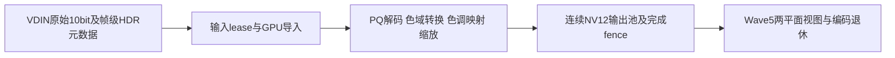

# 7.3 GPU HDR→SDR／缩放规格与第一阶段原型

**2026-10-30路线调整：GPU tone-map shader与DMA适配实现暂停，保留现有提交。**
主路径改为[VDIN HDR2硬件处理](hdr2-hardware-plan.md)，GPU仅缩放/后备；下文保留原型规格与已测边界，不再作为当前实施主线。

GPU方向**用户已于 2026-10-30 确认**：以Panfrost＋Mesa上游方式为准，kbase/libmali仅临时后备。
编译器工作暂停：GCM默认，完整修复系列显式选项；[可审阅邮件补丁](../packaging/gpu/upstream/README.md)仅本地整理，未对外发送。
本轮离线，不访问板子，不改NPU文件、正式内核配置、视频服务或默认部署锁，不push。

后续[窗口A及接口候选](bringup/2026-10-30-gpu-hdr-window-a.md)：原型已移至持久worktree并rebase main@14cc2b2；
GPU候选基于f71b5c6289cb，独立uhd3-gpu1 release，去掉快轮询。颜色门禁通过，但7.3 4K/1080p分别仅12.74/54.61fps，未达目标。
新增外部buffer导入/退休助手、唯一shader的Vulkan生成器及内核lease颜色快照；原始十位写出和生产交接仍未实现。

## 已有实现：不能把保真格式转换当作tone mapping

| 已核实路径 | 实现证据与边界 |
|---|---|
| 5.15普通HDR→SDR | [HDR说明](hdr.md)：VDIN HDR2硬件做PQ/HLG→SDR；tools/hdr-curve.sh生成白点203／峰值1000曲线与sRGB编码表。HLG仍沿用厂商专用表；GPU不是这条链的tone mapper |
| 5.15 GPU保真HDR | gst-plugin-vfmcap/src/amly-gpu.h:13–32、amly-gpu.c:406–424、547–578：AMLY小端Cb-Y-Cr-Y打包10bit→高位P010，保持PQ/BT.2020，external queue ownership、fence后退休输入；r44还等待idle以释放导入引用 |
| GPU缩放 | gst-plugin-vfmcap/src/amly-gpu-scale.c及texture-to-p010.comp:16–45：解包、纹理双线性缩放、输出连续P010，UV垂直平均；没有EOTF/tone map。AMLY是私有像素排列，不能冒充DRM modifier |
| 应用接入 | gst-plugin-vfmcap/src/gstvfmcapsrc.c:279–300、651–673选择GPU及CPU启动回退；gst-plugin-venc/VIM4.md:23–51，vim4h265src给四应用共享私有Main10编码链；启动器隔离libmali/ICD，不全局替换Mesa |
| 7.3采集 | GPU worktree drivers/media/platform/amlogic/t7-hdmirx/t7-vdin-test.c:1578只选择NV12/RGB24；t7-vdin-hdr.h:96起为HDR→SDR NV12，:70–83重载LUT。现有已映射八位帧不能恢复十位HDR，也不能再按PQ解码 |
| 7.3编码 | gst-plugin-venc/wave5/gstvim4wave5enc.c:156只公布NV12；nv12-planes.c:9–52导出两平面视图、VideoMeta及输入lease；目前不能声明P010/Main10。GST_V4L2_PREFER_CONTIGUOUS必须在7.3清除 |

这些为本地固定源码证据；不修改GPU worktree或正式集成工作树。产品历史见
[5.15 GPU链](bringup/2026-10-26-hdr-gpu-pipeline.md)、[7.x映射](hdr.md)。
首要阻塞是未映射十位采集输出／元数据合同；缺失时本原型只能验证离线输入，不能接现有NV12声称完成GPU HDR产品链。

## 数据流与格式合同

| 边界 | 数据／格式 | 当前状态 |
|---|---|---|
| 原型输入 | 紧密P010 LE；Y后UV，10bit在16bit高位；limited 64–940/64–960，中性512；BT.2020 NCL＋PQ；中心色度采样 | 已实现文件输入/合成；不接受已映射NV12或缺失色彩元数据的自动猜测 |
| 厂商输入 | AMLY 422每两像素五字节、实际pitch/capacity | 已有解包可复用，后续适配；不是P010，不直接EGL导入为P010 |
| 生产GPU输入 | 显式fourcc、modifier、平面fd/offset/stride、capacity、位深、EOTF、primaries、range、chroma site、PTS和generation | 待VDIN原始十位能力；只接受已验证LINEAR，不猜AFBC/AFRC或私有排列 |
| 原型输出 | 紧密NV12，Y后交错UV；BT.709 primaries，limited 16–235/16–240 | 已实现；宽须4倍数、高偶数；最大4096×2160，仅同尺寸/降采样 |
| 生产编码输入 | 同一连续dma-buf的两平面视图；pitch/tail padding按Wave5协商，两个plane共享原buffer lease | 接入未实现，不能把原型紧密文件直接视为编码器DMA布局 |

原型每线程写完整4×2块：两条Y uint及一条UV uint，避免两个线程竞争同一32bit字；所有尾部dispatch越界检查。
P010先按平面双线性取样（中心坐标、边界clamp），再做颜色转换；输出UV为对应2×2输出色度平均后量化，禁止逐像素量化后平均。
这是非线性码值域缩放，契合现有保真路径的滤波顺序；线性光缩放作为另一个质量模式评估，不能混用基线。

## API选择与同步

第一阶段使用GLES3.1 compute＋SSBO，EGL surfaceless，不依赖实验PanVK；上传/回读只供离线验证，**没有零拷贝承诺**。
生产优先评估EGL_EXT_image_dma_buf_import及modifiers查询，输入可作为只读Y/UV纹理或external image。
导入成功不证明支持P010采样，也不证明能将同一dma-buf绑定为可写SSBO。
必须核实上游GLES外部buffer／memory扩展的实际handle类型和可写格式；不把opaque-fd等同dma-buf。
若没有安全的可写输出路径，选已有PanVK external_memory_dma_buf SSBO路线，复用现有buffer import合同；
G52 PanVK设备仍实验、已测仅API1.0，现有amly-gpu.c:100的1.1门槛须逐项审查KHR替代，不能只删版本检查。
该选择由能力探测和真实导入门禁决定；本轮未实现两种生产导入后端。

- 输入DQBUF后持有capture lease，确认生产者完成；CPU映射仅在DMA_BUF_IOCTL_SYNC START/END区间，不能拿它代替GPU fence。
- 导入cache以真实buffer身份＋布局＋generation为键，不以可复用fd整数为唯一键；借用fd与GPU持有引用分别释放。
- 优先显式sync_file/native fence；路径不提供显式同步时先做有界完成等待，不能假定所有跨驱动隐式fence都正确。
- GPU完成后才能将输出交Wave5；Wave5 DQBUF/退休后才复用输出。固定双输出起步，记录pending峰值；输入也必须等GPU完成才QBUF。
- timeout/device lost后停止投递，未确认退休的dma-buf隔离、不释放重用；正常重启恢复，禁止强卸载驱动。分辨率/EOTF切换先drain旧generation。
- 能力不足/导入失败时不伪装HDR成功：恢复既有VDIN硬件HDR→SDR NV12；若只供原型可选CPU参考，明确性能降级，不静默进入产品4K CPU转换。

## 色彩合同与验证

PQ limited YCbCr BT.2020 NCL→RGB PQ→ST2084绝对亮度→线性BT.2020到BT.709矩阵→
以最大RGB保持色相比率的203nit白／1000nit扩展Reinhard肩部→sRGB编码→BT.709 YCbCr limited NV12。
系数、白点肩部与CPU参考沿用tools/hdmi-color-check.py:17–74，黑白与中性色独立锚点测试。
这与现有厂商LUT的设计目标一致，**不等于硬件定点/LUT逐码完全一致**；下一阶段导入实际149/143点表与量化规则。
sRGB是既有映射的实际编码曲线，不等于BT.709 OETF；不得只因输出primaries为709就谎报transfer。
产品需明确沿用旧应用的信令兼容行为及像素目标，或单独切换709 OETF后重做颜色验收，不能本轮静默改变。
饱和负分量在色域变换后按当前参考clamp，不宣称完成高级gamut mapping。

HLG：必须取得厂商HLG LUT/系统gamma、显示峰值及信令证据，独立实现逆OETF/OOTF后再入同一线性管线。
本原型只支持显式PQ P010，HLG尚未实现，不能把HLG元数据改成PQ继续执行；动态HDR/Dolby Vision不支持。

不用采集卡：已有RX前矩阵具名10bit Y/Cb/Cr探针→保存匹配原始帧；保存HDR2输入/输出矩阵、LUT和范围状态，
只读已审阅接口，不盲扫MMIO。相同输入与WHITE/PEAK在厂商路径和新GPU路径分别生成NV12，
在编码前逐平面比较黑白、灰阶、肤色、饱和色、高光、范围端点及缩放边缘；输出元数据单独检查。
固定GPU/CPU数学容差每字节≤2，不随结果放宽；厂商LUT误差需先建立固定参考包，未建立前不能声称与5.15逐码一致。
编码后另测重建像素误差，不能把有损编码误差混进GPU容差；没有光度测量不声称面板亮度准确。

## 原型、离线结果与复现

[hdr-probe.c](../packaging/gpu/hdr-probe.c)、[compute](../packaging/gpu/hdr.comp)、
[CPU参考/夹具](../packaging/gpu/hdr-check.py)独立于生产插件，不修改服务。
运行`bash packaging/gpu/hdr-check.sh`：使用builder.lock.json固定ARM64镜像、`--network none`，Werror编译、glslang验证及实际软件GLES执行。
保存P010/NV12、CPU输出、JSON到`build/gpu-hdr/check`。输入长度错误在GPU访问前拒绝；软件执行只允许显式GPU_HDR_ALLOW_SOFTWARE，正常运行要求Mali-G52。

五例覆盖黑/白、随机彩色、同尺寸、整数缩放、48×32→44×22分数缩放和非整工作组尾部。
llvmpipe Mesa25.2.8：四例逐字节相同；64×32随机一例最大1码、平均0.000326码，均通过预定≤2码门限。
纯软件执行时间不作为G52性能数据。该参考没有验证厂商真实帧、HLG、实际DMA padding/lease或GPU硬件正确性。

另外用GCM Mesa26.2.6＋PAN_GPU_ID=0x7402 drm-shim成功编译G52 compute：2235指令、1677tuple、227clause、
23,328bytes、44寄存器、零spill/fill，静态模型67.917 cycles、1线程档位；不能换算FPS。
noop报export failed且不执行GPU，故其输出不能作为像素/导入通过；只引用编译路径和统计。
原型代码体积/44寄存器提示真实负载可能受寄存器占用及pow成本限制，须板测再优化shader，编译器继续暂停。

Werror、glslang、五例像素及短输入/非法宽度负向检查通过。
共享工作区全量unittest为315项、跳过8项；隔离分支为314项、跳过13项，均无失败。
原型ARM64 ELF SHA256 `ecbd863e94f259352269cb5a16763866ac80087e71c27283e9ffae9017182227`；
shader SHA256 `06506ca617b45b52f59562b4a071b4d468128d5516d4c31ad1fa414bb14c7776`。
两封邮件经干净26.2.6 `git am --whitespace=error-all`通过，第二封也可独立应用；未重跑上游main测试，不宣称已适配未来主线。

已保存文件也可直接运行：`timeout -k 3 90 env GPU_HDR_FRAMES=120 hdr-probe hdr.comp IW IH OW OH input.p010 output.nv12`。
4K输入在窗口前离线生成：`python3 packaging/gpu/hdr-check.py --generate 3840 2160 random input.p010`，不在计时期间生成。
先设置私有Mesa逐进程EGL/DRI/库环境；不要继承软件驱动允许开关。程序预热3次，报告dispatch＋glFinish均值/最大值，回读不计时；上传不计时，不能称端到端。

## 性能目标与下一≤20分钟窗口

4K60稳态每16.67ms退休一帧，队列不增长。GPU目标p99≤8ms，导入/同步/交接目标≤1ms，
与Wave5流水并行，不能把串行encode约12ms再与8ms相加宣称16.67ms以内。
实际capture→encoded另设p99≤25ms的初始工程目标并与同窗5.15对照；它不是用户已批准降低5.15性能目标。
4K输入P010约24.9MB＋输出NV12约12.4MB，每帧最低37.3MB（60fps约2.24GB/s），多次采样/中间量及编码另计；
双输出约24.9MB，捕获池和Wave5预留另计，任何失败不能挤占既有KVM可靠回退所需CMA。

| 项目 | 预算 | 门禁 |
|---|---:|---|
| 入场能力及短正确性 | 3分钟 | 锁、真实G52、版本/格式/modifier，全部固定帧逐平面≤2码且GPU timeout/fault零增量，否则停性能项 |
| 离屏4K与1080缩放吞吐 | 5分钟 | 提前生成4K帧，GPU_HDR_FRAMES=120，单项90秒；报告均值/最大值（最大值约束作为更强的p99上界）、CPU、温度/驻留，不能仅报最优样本 |
| 真实VDIN DMA输入 | 5分钟 | **仅原始十位输出及GPU导入后端已离线实现才执行**；记录pitch/offset/capacity/fence/元数据，逐帧退休与像素比对；否则记阻塞，不临时改内核现场试 |
| Wave5交接及并发 | 5分钟 | **仅输出DMA池/同步适配已实现才执行**；无GPU/有GPU各60秒，NV12布局/帧数/PTS/p99/CMA、错误计数；目前原型文件输出不能直接执行这项 |
| 回退与收尾 | 2分钟 | 恢复服务/sysfs，默认5.15、UDC及启动文件哈希；不HID、不音频、不ptrace、不PWM/电压，构建预先结束 |

本轮完成离屏数学原型与上游补丁整理；零拷贝/真实帧/编码接入未完成。
剩余估算：原始十位与导入合同1–2日、DMA后端/池及Wave5接入3–5日、真实负载优化/回归1–3日，
合计5–10工程日，色彩/LUT与HLG验证另2–3日；若十位采集需新驱动接口，额外2–4日。
原6–11日估算只完成第一阶段，不能因离线小图通过大幅下调；保真Main10另行估算，不在本NV12规格内。
