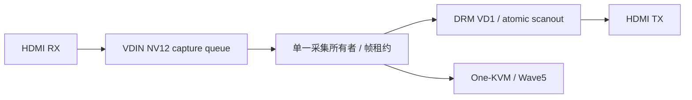

# VIM4 HDMI IN → OUT：第二阶段设计草案

本页定义第二阶段合同；当前实现进度见 [前置稳定性调查](bringup/2026-10-24-hdmi-passthrough.md)。
基于正式 uhd4 的产品对齐差距、资源审计和新阶段门禁见 [7.3 透传计划](passthrough-73-plan.md)。
前提是 [颜色闭环](display-color-vendor.md) 已在目标格式/量化范围下通过，且真实源与自环
持续采集稳定；模式切换、零拷贝和音频不能掩盖颜色或采集失败。
目标是同一 RX/VDIN NV12 帧同时送 DRM VD1 与所选KVM应用，避免整帧 CPU 复制。

## 数据流与缓冲所有权

现有 VDIN 队列只有一个流所有者，不能由透传守护进程和 One-KVM 各自打开并竞争
REQBUFS/STREAMON。采集broker常驻于独立服务，共用已经导出的
DMA-buf 和帧生命周期；四款应用、无客户端及切换应用时本地显示都须持续。管理器负责启停及状态，
不直接操作视频 fd、寄存器或创建第二个采集队列。

一帧只有在 VDIN DQBUF 后才交给消费者。保存 fd、generation、sequence、timestamp、
可见宽高、实际 stride、Y/UV offset、allocation height/size、色彩空间/量化范围。
NV12 通常是单对象双平面；用 PRIME FD 导入并按实际布局建立 DRM framebuffer，
不能假设 UV 紧跟可见高度，也不能用 width 代替 pitch。格式/modifier/尺寸需要双方
枚举和 TEST_ONLY 校验；不向现有 VD1 宣告未验证的 P010/AFBC。

每帧保存 capture、encoder、scanout 三种引用。Wave5 完成输入读取后释放 encoder 引用；
DRM 释放必须遵守现有视频平面的额外扫描周期退休合同，不能在提交成功、收到第一个
vblank 或普通 page-flip event 时提前 QBUF。新帧显示期间保留上一帧至可靠退休。
使用内核提供的 producer fence / IN_FENCE_FD 与退休证据；核对 OUT_FENCE 的真实
语义，不能默认它覆盖驱动的全部安全退休期。故障时 pin 住仍可能被 DMA 使用的帧，
复位前禁止把它归还采集；不能以关闭用户 fd 作为硬件停止的证明。

队列深度由实际占用预算决定，分别计数采集中、encoder 在途、当前扫描、退休中和
可用缓冲。队列满时丢弃尚未提交的显示候选，保留最新完整帧，不能通过覆盖当前
scanout 缓冲降低延迟。One-KVM 有独立丢帧/背压策略，慢浏览器不能阻塞 HDMI OUT。

现有 M3 视频地址更新保守约30次/秒，尚不是60fps透传能力。第二阶段首先验证
VDIN→VD1 的真实 producer 布局、所有权、fence/退休及60fps更新，再讨论延迟优化。
禁止为追帧率缩短未经证明的退休期。

## 模式跟随、EDID 与失锁恢复

状态机：无信号 → 输入资格确认 → 输出 TEST_ONLY → 分配/导入 → 流式显示；
源变化、HPD变化、EIO/ENOLINK、encoder 隔离分别触发对应恢复。
输入由标准 V4L2 DV timings/source-change 事件与完整帧推进确认，不能依据静止画面
像素不变判失锁。输出模式取输入真实 timing 与 sink 能力交集，优先1:1无缩放；
不支持时明确报告受限，并选择已验证降采样模式或黑屏，不把刷新率重命名成匹配。

EDID 策略须用户可选：保留日常固定虚拟显示器，或公布 RX 与 OUT sink 能力的交集。
默认保持当前“无人观看仍在线”语义；OUT 热插拔不自动脉冲 PC 端 HPD。
4K60 RGB/444 需要594MHz与SCDC；420仅在有效EDID模式映射允许时协商，AVI与实际
VPP/TX格式一致。SDR NV12为709 limited；HDR/BT2020在输出路径通过专项前明确拒绝。

重配次序：停止向旧 generation 分发 → 停编码/显示新提交 → blank并等待安全退休 →
STREAMOFF → 释放安全帧/保留故障帧 → 查询新timing → TEST_ONLY → 新队列与FB →
输入稳定后恢复。旧缓冲迟到归还须携带generation，不能回到新队列。
断信号时静音并显示已知黑帧/无信号OSD；单个残留帧不能伪装成实时透传。
信号恢复需要自动重新资格确认，恢复失败有明确状态；不周期性重写EDID或全VPU reset。

## 与 One-KVM、管理器及音频共存

增加透传状态：请求/实际模式、格式/范围、延迟指标、队列占用、丢帧、最近失锁原因、
恢复次数；“配置成功”与“收到新帧并扫描”分开报告。保持现有One-KVM网络推流、录屏、
UU消费者和USB HID；输出模式切换不触碰UDC、PD或共享VDIN仲裁。

音频使用现有 HDMI RX ALSA PCM → 有界环形缓冲 → HDMI TX PCM。
先验证相同48k/S16_LE/2ch的独立全双工路由，再扩展源采样率变化。One-KVM若已持有
RX PCM，由同一音频采集者分发给Opus和TX，避免第二次独占打开同一硬件。
不增加未经验证的TDM/ASRC私有路径；漂移用明确的时钟恢复/重采样策略处理，保存
RX/TX时钟、period、XRUN与补偿记录。HDMI时序变更后重新配置TX ACR。
失锁先静音，重新取得有效采样率和稳定数据后渐入，避免播放陈旧样本或噪声。
自环测试必须关闭音频回送，防止 OUT→IN→OUT 的反馈。

## 对标 5.15 的延迟方法与验收

两种内核在同一板、同一源/线/显示器、同一输入/输出timing、同一像素和音频格式下
做A/B/A，记录版本、EDID、寄存器、队列深度、功耗/温度和网络编码负载。
厂商参考使用其真实HDMI输入透传路径，禁止用软件解码/压缩采集卡替代。

主指标为光学 glass-to-glass：同一动态帧号/黑白跃迁通过已校准分配器同时送参考屏与
VIM4输入，高速相机或双光电探头测两屏同一扫描位置，扣除线缆/分配器和两屏扫描偏差。
保存原始视频/波形、采样频率、帧号、丢帧及P50/P95/P99/max；上下位置另测扫描差。
无需外部屏幕的自环适合颜色/寄存器和队列计时，不能给出端到端光学延迟。

软件拆分同时记录RX frame-done、DQBUF、提交、显示锁存/退休与编码读取完成，
统一CLOCK_MONOTONIC并校准trace开销。不得把DQBUF→atomic ioctl耗时直接叫透传延迟。
音频以同源闪光/脉冲和光电/线路录音比较，区分视频延迟、音频延迟和A/V偏差。

验收覆盖静态/运动、长测、1080p60/4K30/4K60、有效420、源与OUT各自热插拔、
无信号启动、分辨率/采样率变化、慢网络消费者、One-KVM编码并发、队列耗尽及安全退休。
先以与5.15相同条件消除额外整帧等待，再设有测量依据的延迟预算；本草案不预填性能承诺。
